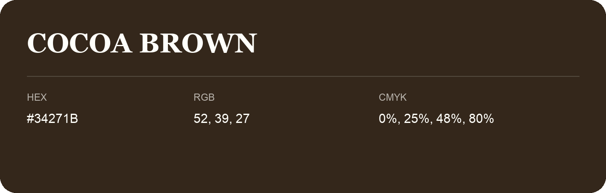

## Cocoa Brown

- HEX: #34271B
- RGB: 52, 39, 27
- CMYK: 0%, 25%, 48%, 80%
- Character: deep, grounded, understated
- Suggested uses: premium packaging, editorial typography, dark backgrounds

- Source images: iCloud Photos 2/IMG_9174.JPG

- Name note: Other distinct shades share this name: [cocoa-brown-33241e](cocoa-brown-33241e.md), [cocoa-brown-34261c](cocoa-brown-34261c.md).
