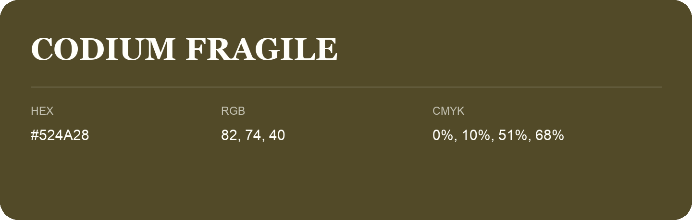

## Codium Fragile

- HEX: #524A28
- RGB: 82, 74, 40
- CMYK: 0%, 10%, 51%, 68%
- Character: deep, grounded, understated
- Suggested uses: premium packaging, editorial typography, dark backgrounds

- Source images: iCloud Photos 2/IMG_9165.JPG
