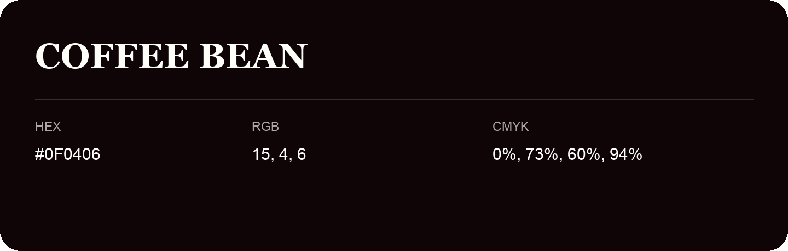

## Coffee Bean

- HEX: #0F0406
- RGB: 15, 4, 6
- CMYK: 0%, 73%, 60%, 94%
- Character: warm, expressive, energetic
- Suggested uses: food brands, expressive identities, promotional accents

- Source images: IMG_8992.JPG

- Data provenance: HEX recovered from page data; cross-checked against the readable source RGB.

- Name note: Other distinct shades share this name: [coffee-bean-211010](coffee-bean-211010.md).
