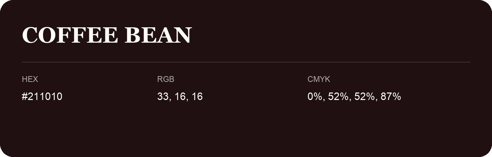

## Coffee Bean

- HEX: #211010
- RGB: 33, 16, 16
- CMYK: 0%, 52%, 52%, 87%
- Character: deep, grounded, understated
- Suggested uses: premium packaging, editorial typography, dark backgrounds

- Source images: IMG_8988.JPG

- Name note: Other distinct shades share this name: [coffee-bean-0f0406](coffee-bean-0f0406.md).
