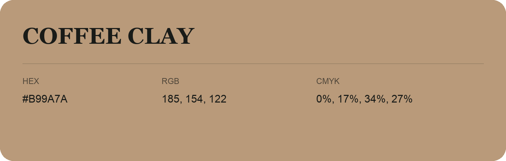

## Coffee Clay

- HEX: #B99A7A
- RGB: 185, 154, 122
- CMYK: 0%, 17%, 34%, 27%
- Character: earthy, rich, warm
- Suggested uses: artisan businesses, hospitality brands, warm accents

- Source images: IMG_9049.JPG

- Data provenance: RGB calculated from HEX, matching the page; source image RGB was unreadable.
