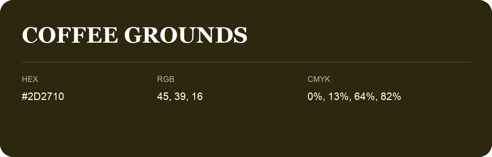

## Coffee Grounds

- HEX: #2D2710
- RGB: 45, 39, 16
- CMYK: 0%, 13%, 64%, 82%
- Character: deep, grounded, understated
- Suggested uses: premium packaging, editorial typography, dark backgrounds

- Source images: iCloud Photos 2/IMG_9165.JPG

- Name note: Other distinct shades share this name: [coffee-grounds-2d1e10](coffee-grounds-2d1e10.md), [coffee-grounds-2e1e14](coffee-grounds-2e1e14.md).
