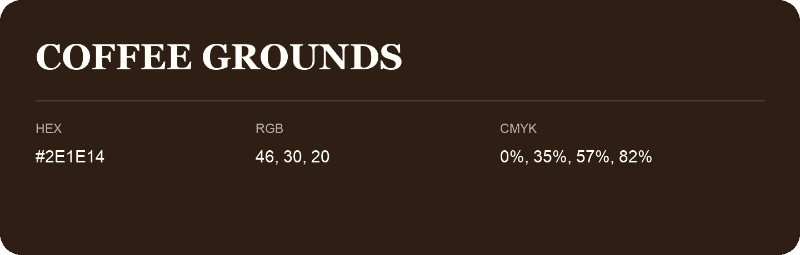

## Coffee Grounds

- HEX: #2E1E14
- RGB: 46, 30, 20
- CMYK: 0%, 35%, 57%, 82%
- Character: deep, grounded, understated
- Suggested uses: premium packaging, editorial typography, dark backgrounds

- Source images: IMG_9043.JPG

- Name note: Other distinct shades share this name: [coffee-grounds-2d1e10](coffee-grounds-2d1e10.md), [coffee-grounds-2d2710](coffee-grounds-2d2710.md).
