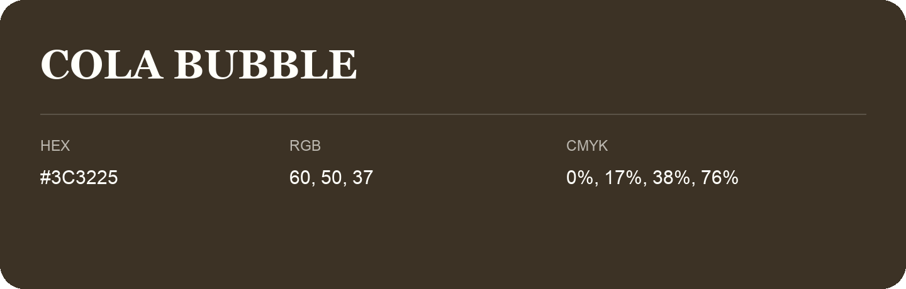

## Cola Bubble

- HEX: #3C3225
- RGB: 60, 50, 37
- CMYK: 0%, 17%, 38%, 76%
- Character: earthy, rich, warm
- Suggested uses: premium packaging, rustic brands, dark backgrounds

- Source images: IMG_9026.JPG
