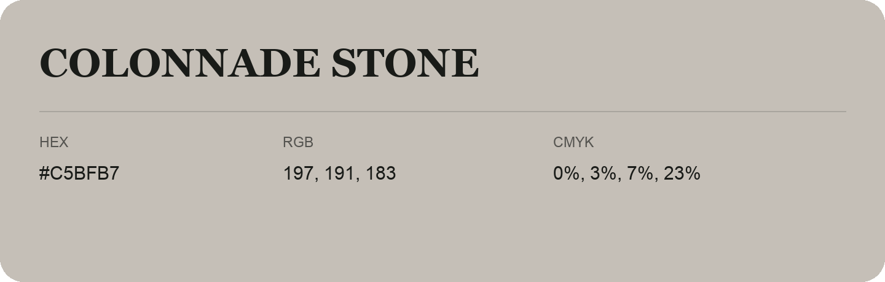

## Colonnade Stone

- HEX: #C5BFB7
- RGB: 197, 191, 183
- CMYK: 0%, 3%, 7%, 23%
- Character: quiet, balanced, understated
- Suggested uses: professional services, minimal identities, supporting backgrounds

- Source images: IMG_9055.JPG
