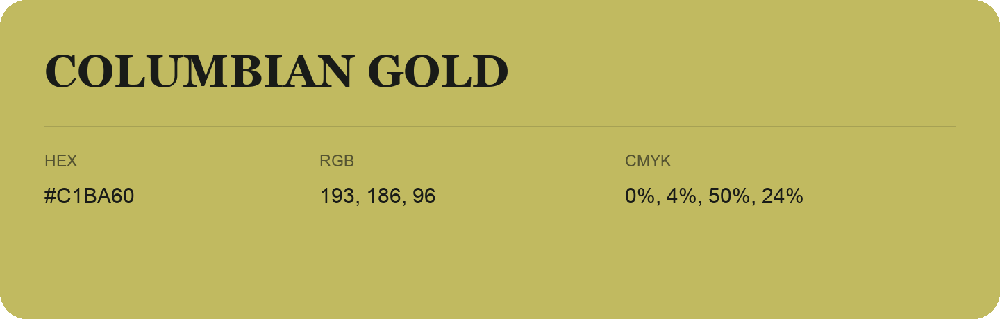

## Columbian Gold

- HEX: #C1BA60
- RGB: 193, 186, 96
- CMYK: 0%, 4%, 50%, 24%
- Character: sunny, lively, optimistic
- Suggested uses: friendly consumer brands, food packaging, cheerful accents

- Source images: IMG_8997.JPG

- Data provenance: RGB calculated from HEX, matching the page; source image RGB was unreadable.
