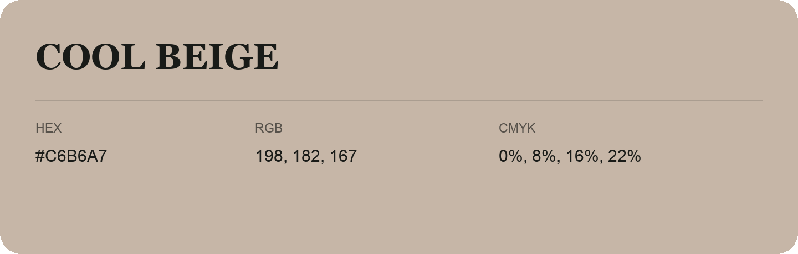

## Cool Beige

- HEX: #C6B6A7
- RGB: 198, 182, 167
- CMYK: 0%, 8%, 16%, 22%
- Character: soft, gentle, approachable
- Suggested uses: friendly consumer brands, gentle backgrounds, welcoming accents

- Source images: IMG_8999.JPG

- Data provenance: RGB calculated from HEX, matching the page; source image RGB was unreadable.

## Consolidated source variants

This is the canonical library entry. Same-name variants below are within ΔE00 ≤ 1 of this shade and were consolidated editorially. Their source values are preserved; they were not source errors.

### Source variant #C5B5A6

- HEX: #C5B5A6
- RGB: 197, 181, 166
- CMYK: 0%, 8%, 16%, 23%
- Difference from canonical: ΔE00 0.2683.
- Source images: iCloud Photos 2/IMG_9135.JPG
