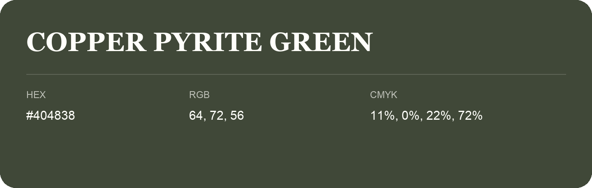

## Copper Pyrite Green

- HEX: #404838
- RGB: 64, 72, 56
- CMYK: 11%, 0%, 22%, 72%
- Character: natural, grounded, fresh
- Suggested uses: outdoor businesses, wellness brands, organic packaging

- Source images: IMG_9063.JPG
