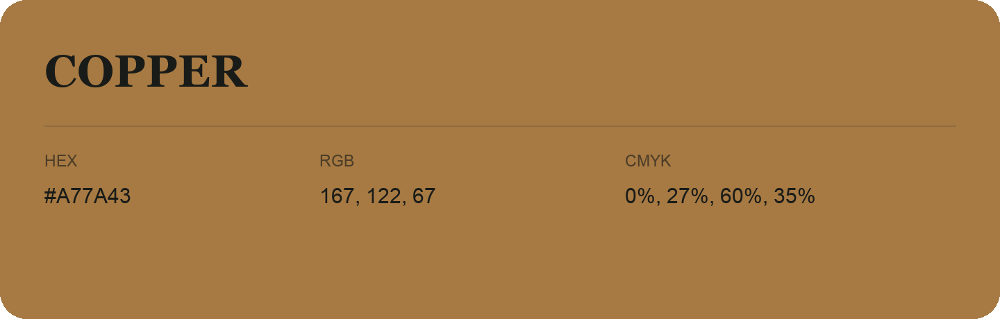

## Copper

- HEX: #A77A43
- RGB: 167, 122, 67
- CMYK: 0%, 27%, 60%, 35%
- Character: earthy, rich, warm
- Suggested uses: artisan businesses, hospitality brands, warm accents

- Source images: IMG_8987.JPG
