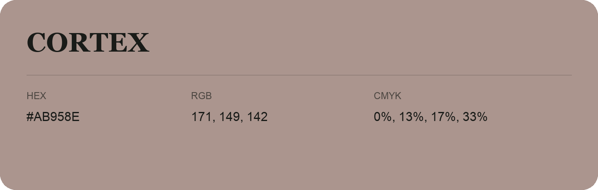

## Cortex

- HEX: #AB958E
- RGB: 171, 149, 142
- CMYK: 0%, 13%, 17%, 33%
- Character: warm, expressive, energetic
- Suggested uses: food brands, expressive identities, promotional accents

- Source images: IMG_8977.JPG
