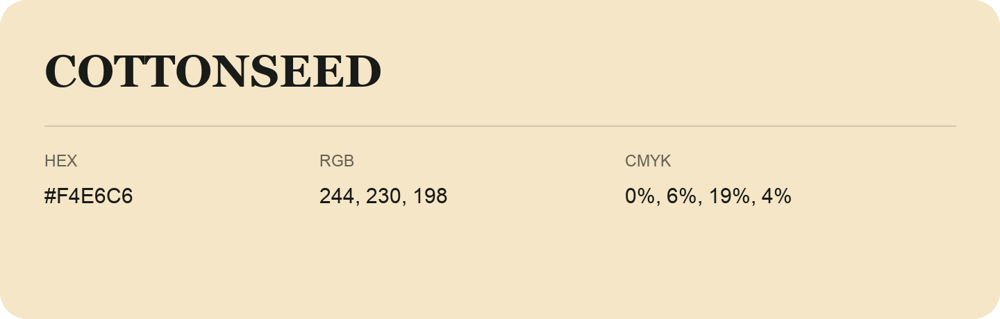

## Cottonseed

- HEX: #F4E6C6
- RGB: 244, 230, 198
- CMYK: 0%, 6%, 19%, 4%
- Character: soft, gentle, approachable
- Suggested uses: friendly consumer brands, gentle backgrounds, welcoming accents

- Source images: iCloud Photos 2/IMG_9122.JPG
