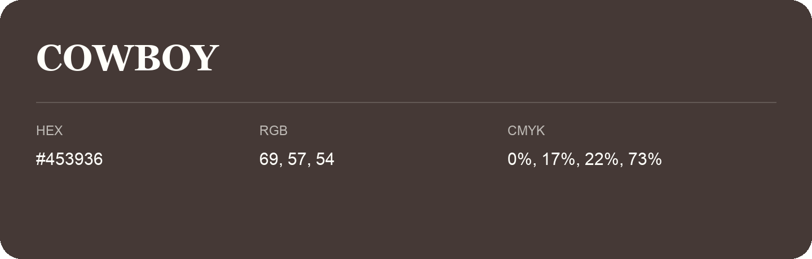

## Cowboy

- HEX: #453936
- RGB: 69, 57, 54
- CMYK: 0%, 17%, 22%, 73%
- Character: warm, expressive, energetic
- Suggested uses: food brands, expressive identities, promotional accents

- Source images: IMG_9094.JPG
