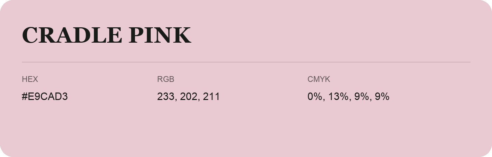

## Cradle Pink

- HEX: #E9CAD3
- RGB: 233, 202, 211
- CMYK: 0%, 13%, 9%, 9%
- Character: soft, warm, playful
- Suggested uses: friendly consumer brands, gentle backgrounds, welcoming accents

- Source images: IMG_9006.JPG
