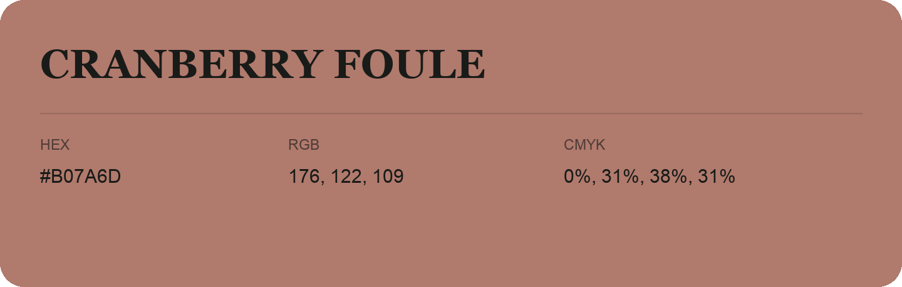

## Cranberry Foule

- HEX: #B07A6D
- RGB: 176, 122, 109
- CMYK: 0%, 31%, 38%, 31%
- Character: warm, expressive, energetic
- Suggested uses: food brands, expressive identities, promotional accents

- Source images: iCloud Photos 2/IMG_9143.JPG
