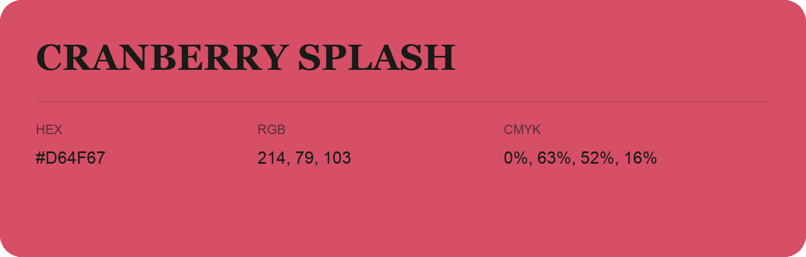

## Cranberry Splash

- HEX: #D64F67
- RGB: 214, 79, 103
- CMYK: 0%, 63%, 52%, 16%
- Character: warm, expressive, energetic
- Suggested uses: food brands, expressive identities, promotional accents

- Source images: IMG_9082.JPG
