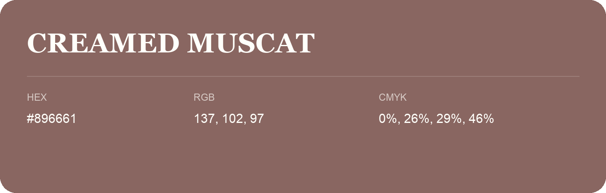

## Creamed Muscat

- HEX: #896661
- RGB: 137, 102, 97
- CMYK: 0%, 26%, 29%, 46%
- Character: warm, expressive, energetic
- Suggested uses: food brands, expressive identities, promotional accents

- Source images: IMG_9114.JPG
