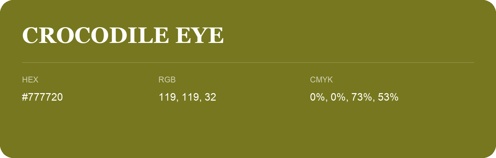

## Crocodile Eye

- HEX: #777720
- RGB: 119, 119, 32
- CMYK: 0%, 0%, 73%, 53%
- Character: sunny, lively, optimistic
- Suggested uses: friendly consumer brands, food packaging, cheerful accents

- Source images: iCloud Photos 2/IMG_9147.JPG

- Name note: Other distinct shades share this name: [crocodile-eye](crocodile-eye.md).
