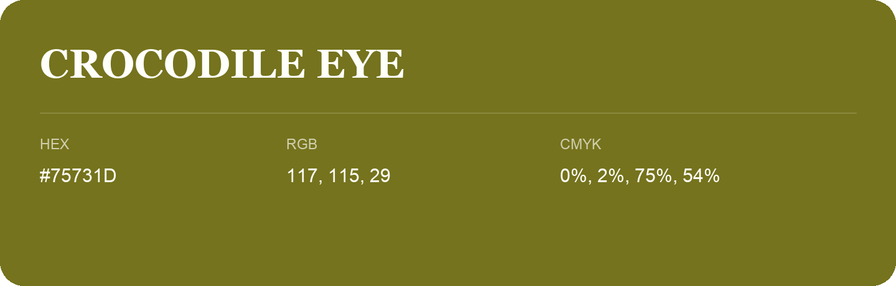

## Crocodile Eye

- HEX: #75731D
- RGB: 117, 115, 29
- CMYK: 0%, 2%, 75%, 54%
- Character: sunny, lively, optimistic
- Suggested uses: friendly consumer brands, food packaging, cheerful accents

- Source images: iCloud Photos 2/IMG_9124.JPG

- Name note: Other distinct shades share this name: [crocodile-eye-777720](crocodile-eye-777720.md).
