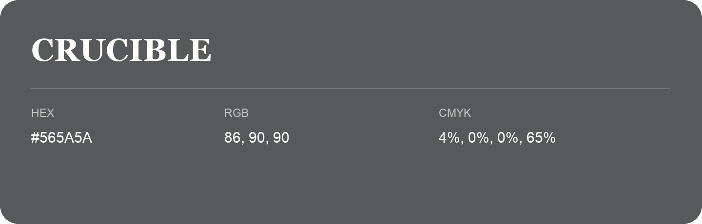

## Crucible

- HEX: #565A5A
- RGB: 86, 90, 90
- CMYK: 4%, 0%, 0%, 65%
- Character: deep, grounded, understated
- Suggested uses: premium packaging, editorial typography, dark backgrounds

- Source images: IMG_9068.JPG

- Name note: Other distinct shades share this name: [crucible-565c5a](crucible-565c5a.md).
