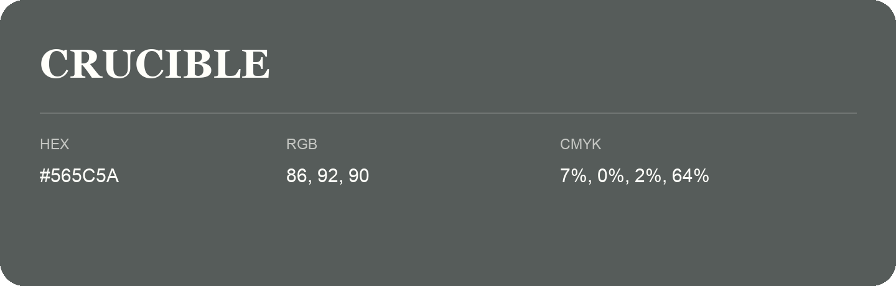

## Crucible

- HEX: #565C5A
- RGB: 86, 92, 90
- CMYK: 7%, 0%, 2%, 64%
- Character: deep, grounded, understated
- Suggested uses: premium packaging, editorial typography, dark backgrounds

- Source images: IMG_9039.JPG

- Name note: Other distinct shades share this name: [crucible-565a5a](crucible-565a5a.md).
