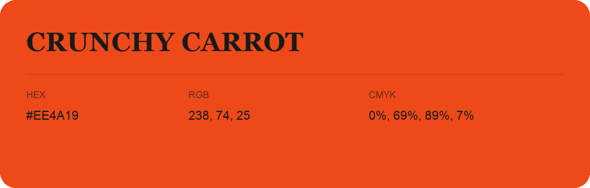

## Crunchy Carrot

- HEX: #EE4A19
- RGB: 238, 74, 25
- CMYK: 0%, 69%, 89%, 7%
- Character: warm, expressive, energetic
- Suggested uses: food brands, expressive identities, promotional accents

- Source images: IMG_8977.JPG

- Data provenance: RGB calculated from HEX, matching the page; source image RGB was unreadable.
