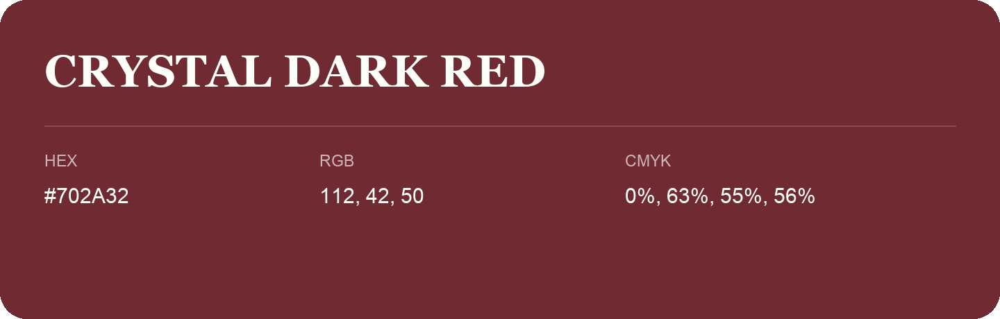

## Crystal Dark Red

- HEX: #702A32
- RGB: 112, 42, 50
- CMYK: 0%, 63%, 55%, 56%
- Character: warm, expressive, energetic
- Suggested uses: food brands, expressive identities, promotional accents

- Source images: IMG_9109.JPG
