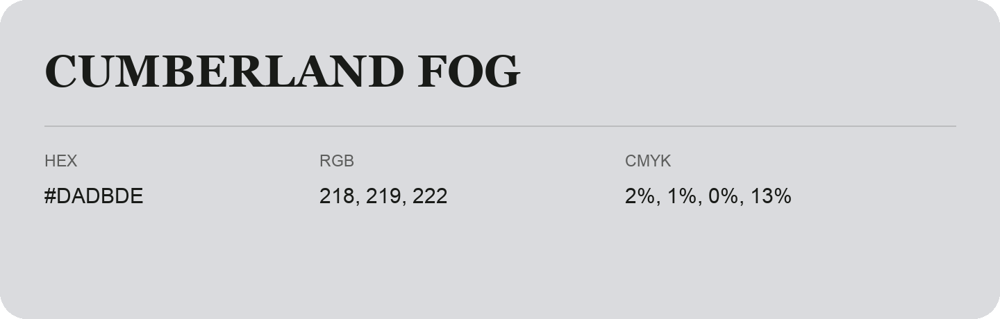

## Cumberland Fog

- HEX: #DADBDE
- RGB: 218, 219, 222
- CMYK: 2%, 1%, 0%, 13%
- Character: quiet, balanced, understated
- Suggested uses: professional services, minimal identities, supporting backgrounds

- Source images: IMG_9105.JPG

- Data provenance: HEX recovered from page data; cross-checked against the readable source RGB.
