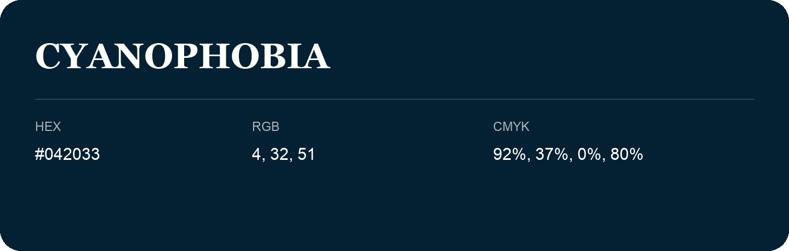

## Cyanophobia

- HEX: #042033
- RGB: 4, 32, 51
- CMYK: 92%, 37%, 0%, 80%
- Character: cool, composed, dependable
- Suggested uses: professional services, technology brands, calm backgrounds

- Source images: IMG_9036.JPG
