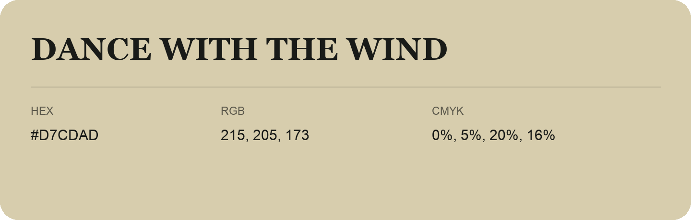

## Dance With The Wind

- HEX: #D7CDAD
- RGB: 215, 205, 173
- CMYK: 0%, 5%, 20%, 16%
- Character: soft, gentle, approachable
- Suggested uses: friendly consumer brands, gentle backgrounds, welcoming accents

- Source images: IMG_9093.JPG

- Data provenance: RGB calculated from HEX, matching the page; source image RGB was unreadable.
