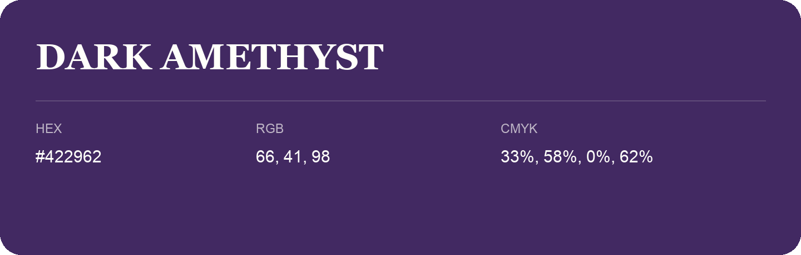

## Dark Amethyst

- HEX: #422962
- RGB: 66, 41, 98
- CMYK: 33%, 58%, 0%, 62%
- Character: expressive, imaginative, refined
- Suggested uses: beauty brands, creative businesses, distinctive accents

- Source images: IMG_8986.JPG
