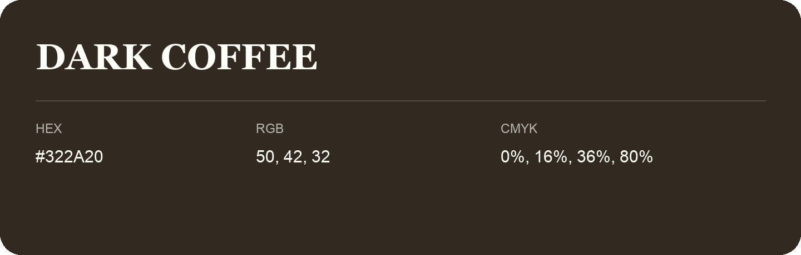

## Dark Coffee

- HEX: #322A20
- RGB: 50, 42, 32
- CMYK: 0%, 16%, 36%, 80%
- Character: earthy, rich, warm
- Suggested uses: premium packaging, rustic brands, dark backgrounds

- Source images: IMG_8983.JPG
