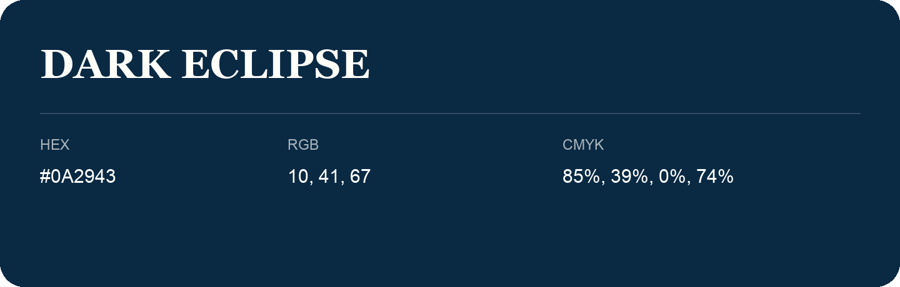

## Dark Eclipse

- HEX: #0A2943
- RGB: 10, 41, 67
- CMYK: 85%, 39%, 0%, 74%
- Character: deep, grounded, understated
- Suggested uses: premium packaging, editorial typography, dark backgrounds

- Source images: iCloud Photos 2/IMG_9163.JPG
