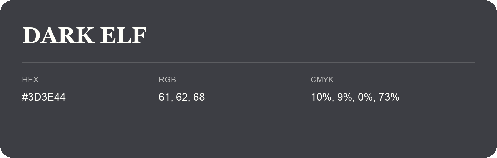

## Dark Elf

- HEX: #3D3E44
- RGB: 61, 62, 68
- CMYK: 10%, 9%, 0%, 73%
- Character: restrained, grounded, sophisticated
- Suggested uses: premium brands, editorial typography, dark backgrounds

- Source images: IMG_9034.JPG
