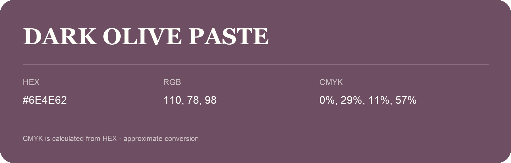

## Dark Olive Paste

- HEX: #6E4E62
- RGB: 110, 78, 98
- CMYK: 0%, 29%, 11%, 57%
- Character: expressive, imaginative, refined
- Suggested uses: beauty brands, creative businesses, distinctive accents

- Source images: iCloud Photos 2/IMG_9167.JPG
- Data provenance: CMYK calculated from HEX; source text recognition was uncertain. Approximate conversion without a print color profile.
