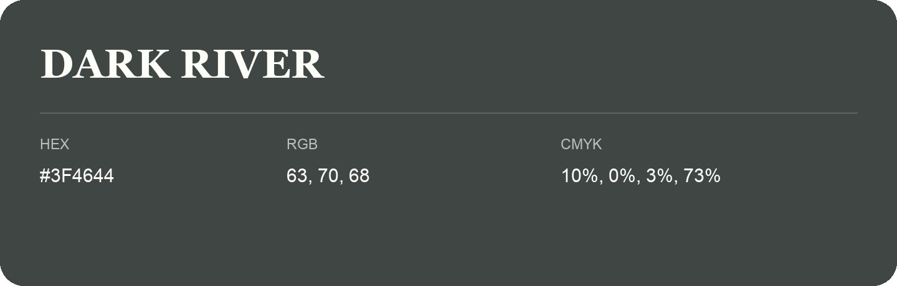

## Dark River

- HEX: #3F4644
- RGB: 63, 70, 68
- CMYK: 10%, 0%, 3%, 73%
- Character: restrained, grounded, sophisticated
- Suggested uses: premium brands, editorial typography, dark backgrounds

- Source images: IMG_9076.JPG
