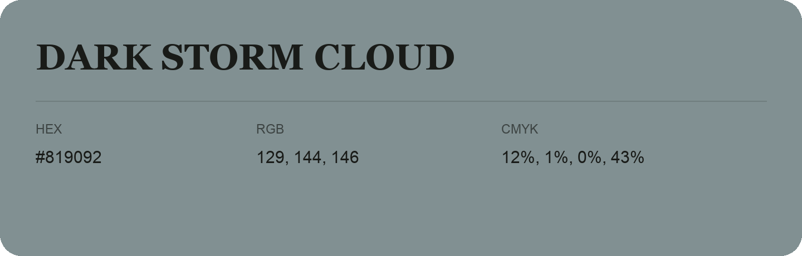

## Dark Storm Cloud

- HEX: #819092
- RGB: 129, 144, 146
- CMYK: 12%, 1%, 0%, 43%
- Character: quiet, balanced, understated
- Suggested uses: professional services, minimal identities, supporting backgrounds

- Source images: IMG_9010.JPG
