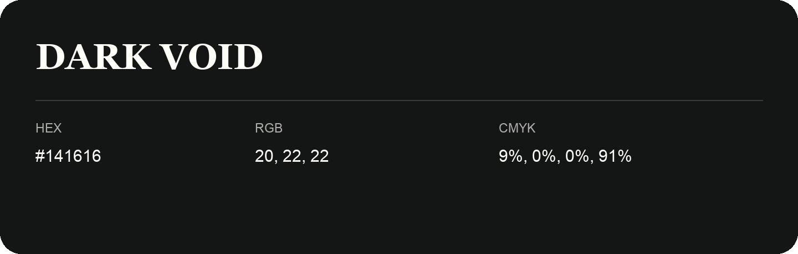

## Dark Void

- HEX: #141616
- RGB: 20, 22, 22
- CMYK: 9%, 0%, 0%, 91%
- Character: deep, grounded, understated
- Suggested uses: premium packaging, editorial typography, dark backgrounds

- Source images: iCloud Photos 2/IMG_9151.JPG
