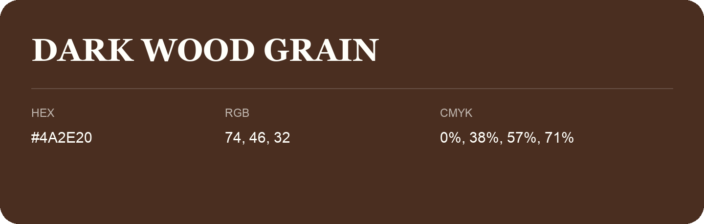

## Dark Wood Grain

- HEX: #4A2E20
- RGB: 74, 46, 32
- CMYK: 0%, 38%, 57%, 71%
- Character: earthy, rich, warm
- Suggested uses: premium packaging, rustic brands, dark backgrounds

- Source images: IMG_9079.JPG
