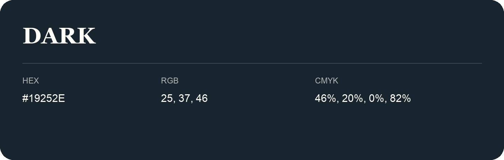

## Dark

- HEX: #19252E
- RGB: 25, 37, 46
- CMYK: 46%, 20%, 0%, 82%
- Character: deep, grounded, understated
- Suggested uses: premium packaging, editorial typography, dark backgrounds

- Source images: iCloud Photos 2/IMG_9156.JPG
