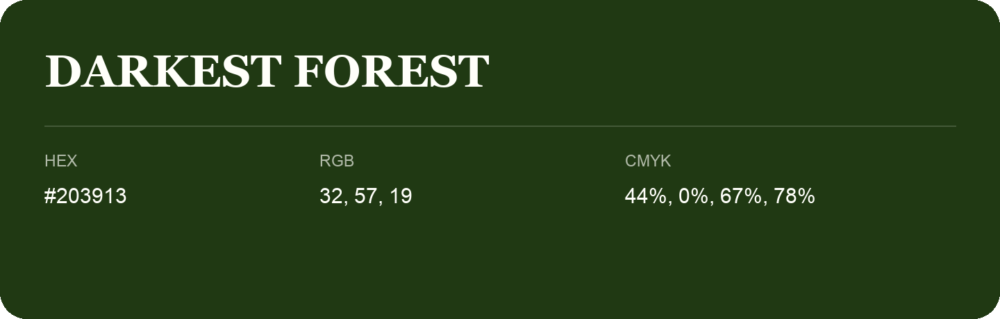

## Darkest Forest

- HEX: #203913
- RGB: 32, 57, 19
- CMYK: 44%, 0%, 67%, 78%
- Character: deep, grounded, understated
- Suggested uses: premium packaging, editorial typography, dark backgrounds

- Source images: IMG_9038.JPG

- Name note: Other distinct shades share this name: [darkest-forest-26300a](darkest-forest-26300a.md), [darkest-forest-293011](darkest-forest-293011.md).
