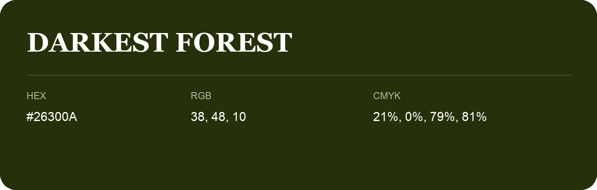

## Darkest Forest

- HEX: #26300A
- RGB: 38, 48, 10
- CMYK: 21%, 0%, 79%, 81%
- Character: deep, grounded, understated
- Suggested uses: premium packaging, editorial typography, dark backgrounds

- Source images: IMG_9050.JPG

- Name note: Other distinct shades share this name: [darkest-forest-203913](darkest-forest-203913.md), [darkest-forest-293011](darkest-forest-293011.md).
