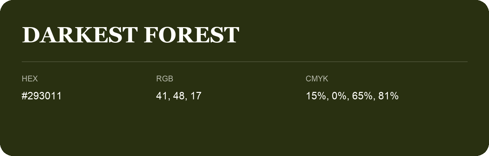

## Darkest Forest

- HEX: #293011
- RGB: 41, 48, 17
- CMYK: 15%, 0%, 65%, 81%
- Character: deep, grounded, understated
- Suggested uses: premium packaging, editorial typography, dark backgrounds

- Source images: iCloud Photos 2/IMG_9140.JPG

- Name note: Other distinct shades share this name: [darkest-forest-203913](darkest-forest-203913.md), [darkest-forest-26300a](darkest-forest-26300a.md).
