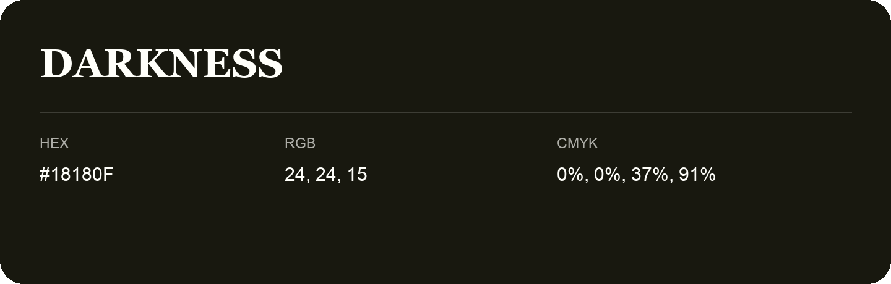

## Darkness

- HEX: #18180F
- RGB: 24, 24, 15
- CMYK: 0%, 0%, 37%, 91%
- Character: deep, grounded, understated
- Suggested uses: premium packaging, editorial typography, dark backgrounds

- Source images: iCloud Photos 2/IMG_9123.JPG

- Name note: Other distinct shades share this name: [darkness](darkness.md).
