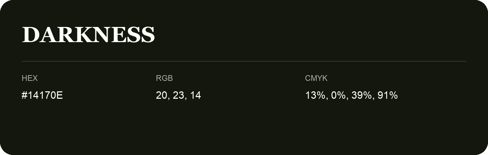

## Darkness

- HEX: #14170E
- RGB: 20, 23, 14
- CMYK: 13%, 0%, 39%, 91%
- Character: natural, grounded, fresh
- Suggested uses: outdoor businesses, wellness brands, organic packaging

- Source images: IMG_9040.JPG

- Name note: Other distinct shades share this name: [darkness-18180f](darkness-18180f.md).
