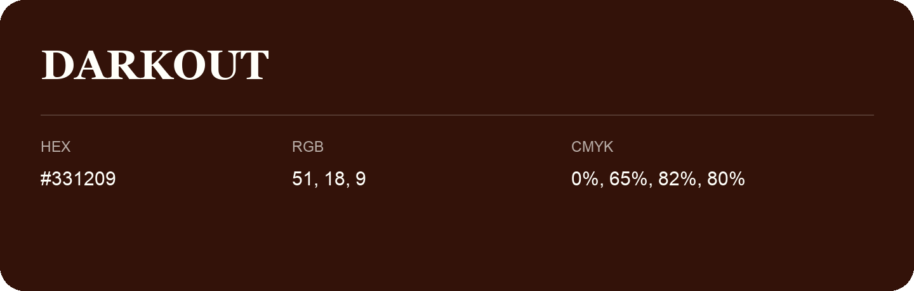

## Darkout

- HEX: #331209
- RGB: 51, 18, 9
- CMYK: 0%, 65%, 82%, 80%
- Character: deep, grounded, understated
- Suggested uses: premium packaging, editorial typography, dark backgrounds

- Source images: iCloud Photos 2/IMG_9169.JPG
