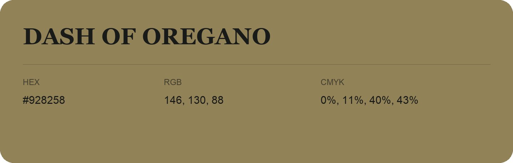

## Dash Of Oregano

- HEX: #928258
- RGB: 146, 130, 88
- CMYK: 0%, 11%, 40%, 43%
- Character: earthy, rich, warm
- Suggested uses: artisan businesses, hospitality brands, warm accents

- Source images: iCloud Photos 2/IMG_9187.JPG
- Data provenance: RGB calculated from HEX; source text recognition was uncertain.
