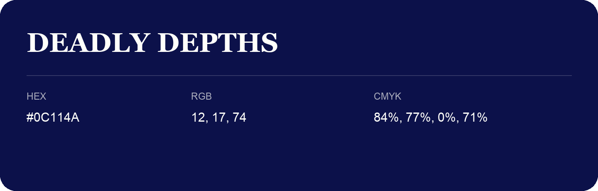

## Deadly Depths

- HEX: #0C114A
- RGB: 12, 17, 74
- CMYK: 84%, 77%, 0%, 71%
- Character: deep, grounded, understated
- Suggested uses: premium packaging, editorial typography, dark backgrounds

- Source images: iCloud Photos 2/IMG_9170.JPG
