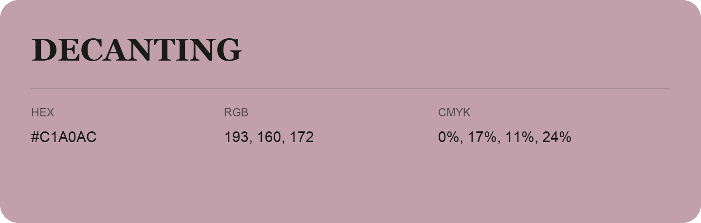

## Decanting

- HEX: #C1A0AC
- RGB: 193, 160, 172
- CMYK: 0%, 17%, 11%, 24%
- Character: soft, warm, playful
- Suggested uses: friendly consumer brands, gentle backgrounds, welcoming accents

- Source images: IMG_9108.JPG

- Data provenance: HEX recovered from page data; cross-checked against the readable source RGB.
