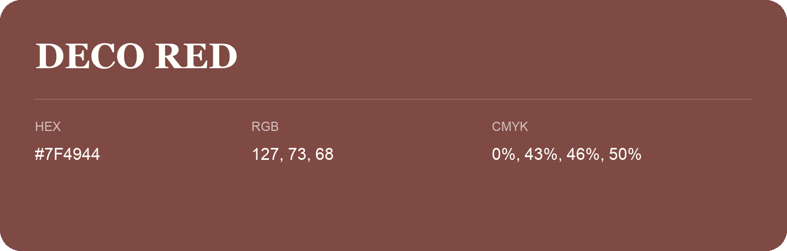

## Deco Red

- HEX: #7F4944
- RGB: 127, 73, 68
- CMYK: 0%, 43%, 46%, 50%
- Character: warm, expressive, energetic
- Suggested uses: food brands, expressive identities, promotional accents

- Source images: IMG_9117.JPG
