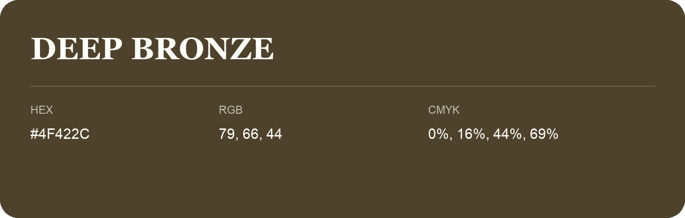

## Deep Bronze

- HEX: #4F422C
- RGB: 79, 66, 44
- CMYK: 0%, 16%, 44%, 69%
- Character: deep, grounded, understated
- Suggested uses: premium packaging, editorial typography, dark backgrounds

- Source images: IMG_9035.JPG

## Consolidated source variants

This is the canonical library entry. Same-name variants below are within ΔE00 ≤ 1 of this shade and were consolidated editorially. Their source values are preserved; they were not source errors.

### Source variant #50432C

- HEX: #50432C
- RGB: 80, 67, 44
- CMYK: 0%, 16%, 45%, 69%
- Difference from canonical: ΔE00 0.5139.
- Source images: IMG_9072.JPG
